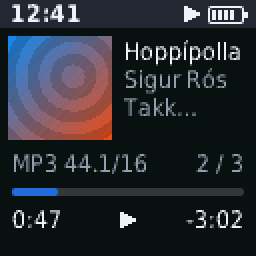
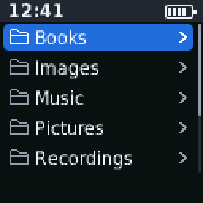
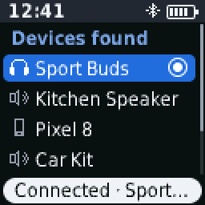

<p align="center"></p>

# Orpheus

**Website:** <https://timschmidt.github.io/orpheus/>

A new firmware for the **Yoton YM03** MP3 player, written from scratch in
Rust on [Embassy](https://embassy.dev). It plays MP3, FLAC, Ogg Vorbis,
Opus, Speex and WAV with gapless joins and an equaliser, sorts folders of
thousands of files, builds a music library, shows pictures and sends music to
Bluetooth headphones, on a 128 × 128 screen with 320 KiB of RAM.

<p align="center">
  
  
  
</p>

**Status (2026-11-24):** runs every day on the reference player: Music,
Files, Now Playing, Pictures, Bluetooth audio and Settings work. Radio,
recorder, the authenticator, USB disk images and the Bluetooth presenter
remote are planned. Not released yet; see the [changelog](CHANGELOG.md)
and the [detailed log](docs/STATUS.md).

## Try it

**In your browser:** [timschmidt.github.io/orpheus/try.html](https://timschmidt.github.io/orpheus/try.html)
runs the real screens, file system, library, decoders and sound settings
compiled to WebAssembly, with a demo card and room for your own files
(they stay in your browser). The desktop simulator runs the same screens
(see Build below):

```sh
cargo run -p orpheus-sim --features window -- --window
```

## Install

**From the browser: coming** (a backup-first installer for Chromium-based
browsers). **From the command line** today, on Linux, with the steps,
the backup and the way back to the original firmware in the manual:
[install, update and restore](docs/user/install.md). Read it first: the
tools are still set up for the project's reference player.

## Build

```sh
git clone https://github.com/timschmidt/orpheus && cd orpheus
cargo test --workspace      # host crates, simulator and golden images
cargo xtask build           # firmware image: target/orpheus/firmware.yfw
cargo xtask gate --no-dev   # everything a change must pass
```

The toolchain is pinned in `rust-toolchain.toml`; nothing else is needed.
More in [getting started](docs/dev/getting-started.md).

## Documentation

| For | Read |
|---|---|
| Using the player | [Manual](docs/user/README.md) · [FAQ](docs/user/faq.md) · [Troubleshooting](docs/user/troubleshooting.md) |
| Developing | [Getting started](docs/dev/getting-started.md) · [Architecture](docs/dev/architecture.md) · [How-to guides](docs/dev/how-to/README.md) |
| The plan | [PLAN.md](docs/PLAN.md) · [Milestones](docs/plan/08-milestones.md) · [STATUS.md](docs/STATUS.md) |
| Contributing | [CONTRIBUTING.md](CONTRIBUTING.md) · [Code of Conduct](CODE_OF_CONDUCT.md) · [Security](SECURITY.md) |
| Brand | [Logo, palette and rules](docs/brand/README.md) |

The reverse-engineering notes on the hardware (`docs/hw/`) and the vendor
documents stay out of the repository (decision D-7 in the plan). The
Rockbox port in the companion repository
([yoton-rockbox](https://github.com/timschmidt/yoton-rockbox)) is a
hardware reference only.

## Licence

Licensed under either of

* Apache License, Version 2.0 ([LICENSE-APACHE](LICENSE-APACHE))
* MIT license ([LICENSE-MIT](LICENSE-MIT))

at your option. The Opus and Speex decoder ports keep the BSD-3-Clause
licence of the Xiph originals, and the bundled fonts keep theirs; see
[THIRD-PARTY.md](THIRD-PARTY.md).

Unless you explicitly state otherwise, any contribution intentionally
submitted for inclusion in the work by you, as defined in the Apache-2.0
license, shall be dual licensed as above, without any additional terms or
conditions.
