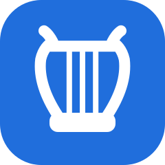
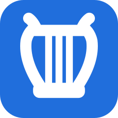
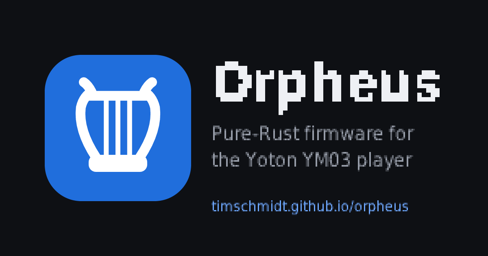

# Orpheus brand

One source for how Orpheus looks in the firmware, the documentation and on
the website (plan: [09 §6](../plan/09-docs-website.md)).

| File | What | Edited by |
|---|---|---|
| [`../logo/orpheus-lyre.svg`](../logo/orpheus-lyre.svg) | The logo: a white lyre on a blue tile | hand |
| [`palette.toml`](palette.toml) | Every colour, by role, for dark and light | hand |
| [`generated/`](generated/) | Everything below | `cargo xtask brand` |

`cargo xtask brand` checks the palette's contrast and rewrites
`generated/`. `cargo xtask brand --check` (in the gate and in CI) fails when
a pairing is too weak or a generated file is not what the generator makes
now: after changing the logo or the palette, run `cargo xtask brand` and
commit the result.

## The logo

| | File | Use |
|---|---|---|
|  | `../logo/orpheus-lyre.svg` | Default, 48 px and larger |
|  | `generated/orpheus-lyre-small.svg` | 16–47 px: favicons, toolbars. Heavier strokes, tighter tile |
|  | `generated/orpheus-lyre-mono.svg` | One colour, no tile: `currentColor` when inlined, black as a file. Print, watermarks, single-colour places |
|  | `generated/wordmark.svg` | "Orpheus" in the firmware's own bold bitmap font, `currentColor` |

Rules:

* **Clear space**: keep a quarter of the tile's width free around it.
* **Minimum size**: 16 px for the small variant, 48 px for the full logo.
* **Do** use the tile colour `lyre` from the palette and white for the
  drawing; on a coloured or busy background use the tile, not the mono
  lyre.
* **Don't** recolour the lyre in other colours, stretch it, add shadows or
  outlines, rotate it, or put text inside the tile.
* **Name**: "Orpheus" in text; `orpheus` for crates, folders and
  identifiers. The wordmark is for headers; body text uses the plain word.

## Colour

Roles, not colours: everything (firmware, CSS, diagrams) asks for a role.

| Role | Dark | Light | For |
|---|---|---|---|
| `bg` | `#0e1014` | `#f8f8fa` | Page and screen background |
| `surface` | `#242830` | `#e2e5eb` | Bars, cards, code blocks |
| `text` | `#eef0f4` | `#121418` | Body text, icons |
| `text-dim` | `#969ca8` | `#585e68` | Secondary text |
| `primary` | `#206edc` | `#005cc8` | Focus, selection, buttons |
| `on-primary` | `#ffffff` | `#ffffff` | Text on `primary` |
| `link` | `#6ea8ff` | `#005cc8` | Links (web only) |
| `accent` | `#ffb800` | `#8a5a00` | Highlights, "in progress" (web only) |
| `warning` | `#ff6058` | `#c42020` | Errors, destructive actions |
| `good` | `#48cc78` | `#108040` | Success, charging, "works" |

**Contrast** (checked by `xtask brand`): text, text-dim, link, warning,
good and accent on their backgrounds, and on-primary on primary, at least
4.5:1 (WCAG 2.2 AA for text); primary on bg and accent on surface at least
3:1 (non-text). The pairings the screen draws are checked a second time
after rounding to RGB565, the way the 128 × 128 panel stores colour.

**Website**: `generated/palette.css` defines `--o-<role>` custom
properties (and `--o-lyre`, `--o-on-lyre`): light by default, dark under
`prefers-color-scheme: dark`, and either one forced by
`<html data-theme="dark|light">`.

### The firmware's theme tables

The `dark` and `light` schemes are exactly the firmware's Dark and Light
themes with the Blue accent (`crates/orpheus-ui/src/theme.rs`):

| Palette role | `orpheus_ui::theme::Role` |
|---|---|
| `bg` | `Bg` |
| `surface` | `Surface` |
| `text` | `Text` |
| `text-dim` | `TextDim` |
| `primary` | `Accent` (the `Accent::Blue` pair: dark, light) |
| `on-primary` | `OnAccent` |
| `warning` | `Warning` |
| `good` | `Good` |

`link` and `accent` have no firmware role. The firmware's Amber theme and
the Green, Pink, Red and Grey accents are not in the palette.
`cargo xtask brand` says whether the firmware tables still equal the
palette (a unit test fails if they drift apart). The theme tables are still
written by hand in `theme.rs`; generating them from `palette.toml` is a
follow-up (BRAND-1 leaves firmware code unchanged).

## Generated files

| File | Size | Use |
|---|---|---|
| `favicon.ico` | 16, 32, 48 px | Old browsers |
| `favicon-16.png`, `favicon-32.png`, `favicon-48.png` | | `<link rel="icon">` |
| `orpheus-lyre-small.svg` | vector | `<link rel="icon" type="image/svg+xml">` |
| `apple-touch-icon.png` | 180 px, square tile | iOS home screen |
| `icon-192.png`, `icon-512.png` | | Web app manifest |
| `social-card.png` | 1200 × 630 | Open Graph / social previews |
| `palette.css` | | Website custom properties |
| `wordmark.svg` | | Site header |

## Type and voice

* Headings on the site use the wordmark only; body text uses the system UI
  font (no web fonts are downloaded). A web-font subset of the firmware's
  bitmap font is a follow-up.
* Voice: concise, friendly, plain; present tense; numbers with units; no
  marketing words in technical pages.

## Not yet generated (follow-ups)

* The firmware's 128 × 128 boot logo and its 16/24/32 px icons from the same
  SVG (today `crates/orpheus-apps/icongen/icons.py` draws the 24 px lyre).
* The firmware theme tables from `palette.toml`.
