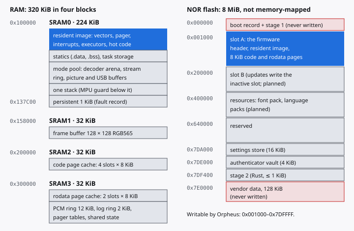
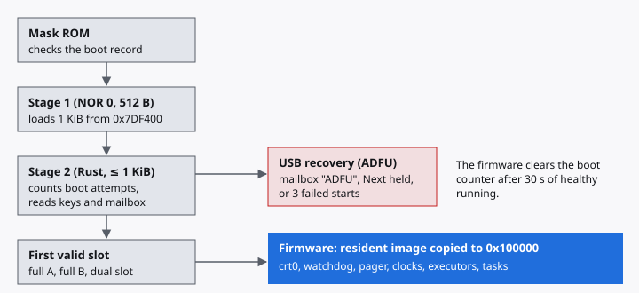
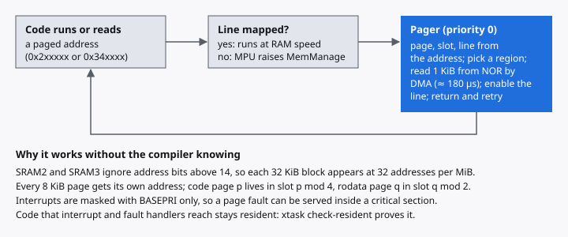
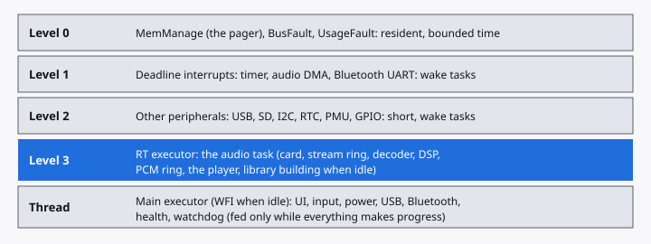
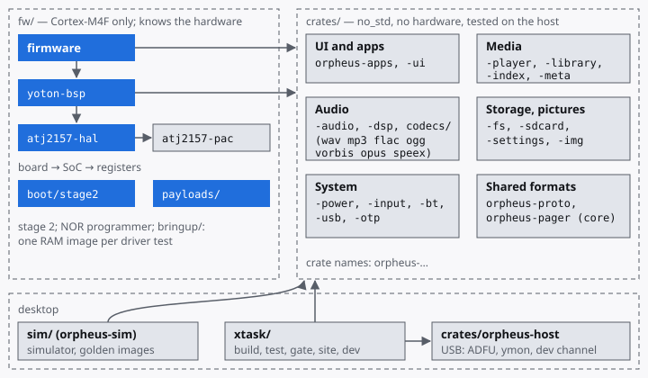

# Architecture

One page on how Orpheus is put together. The depth is in
[02-architecture.md](../plan/02-architecture.md) (memory, boot, paging,
tasks, power, storage), [03](../plan/03-hal-drivers.md) (drivers),
[04](../plan/04-audio.md) (audio) and [05](../plan/05-ui-apps.md) (UI).

Three facts decide almost everything:

1. **320 KiB of RAM and no execute-in-place.** The 8 MiB flash is on SPI
   and not memory-mapped; all code must be copied to RAM before it runs,
   and the firmware is several times larger than the RAM.
2. **A Cortex-M4F at 24–288 MHz** (1.0 V core supply up to 144 MHz): decoding takes a
   noticeable share of real time, so scheduling and clock control are part
   of the audio design.
3. **No debugger.** Everything is observed over USB and through RAM that
   survives a reset.

## Memory

SRAM0 holds the resident image, the statics, one shared **mode pool**
(re-partitioned for playback, pictures or USB storage) and the single
stack. SRAM1 is exactly the 128 × 128 RGB565 frame buffer, so a screenshot
is a memory read. SRAM2 and SRAM3 are the page caches, plus the PCM ring and
the log ring. Budgets live in [`budgets.toml`](../../budgets.toml) and
`cargo xtask size --check` enforces them.

## Boot

The mask ROM's USB recovery mode (ADFU) is always reachable: by a mailbox
word, by holding Next, after three failed starts, and when the boot record
is invalid. That is what makes aggressive development safe. The slot
format (`"YFW1"`: header, resident image, 8 KiB pages) is in
[02 §2.3](../plan/02-architecture.md).

## Demand paging

`cargo xtask build` links the firmware twice: `xtask pagelink` decides
what is resident (everything reachable from interrupt and fault handlers,
listed by [`resident.toml`](../../resident.toml) and proven by
`cargo xtask check-resident`) and packs the rest into 8 KiB pages, hot
code first in clusters from [`hot.toml`](../../hot.toml). The pager itself
(`orpheus-pager`) has a host-side core with trace tests. A function that
must stay resident while the flash is busy needs `#[inline(never)]` as well
as a root: the proof cannot see inlined copies.

## Executors and tasks

Two Embassy executors share one stack. The RT executor runs at interrupt
level 3 and preempts thread mode, so a long UI operation (sorting a
directory, drawing a list) cannot starve the decoder. Critical sections
mask with BASEPRI, never PRIMASK: a page fault under PRIMASK would be
fatal. Tasks talk through `embassy-sync` channels and snapshot cells.

## Crates

* **`crates/`**: everything that does not need the hardware: UI toolkit
  and apps, player and library, file system, codecs, DSP, picture
  decoders, Bluetooth and USB protocol logic, settings store, power policy.
  All `no_std`, no `alloc`, tested on the host first.
* **`fw/`**: the second workspace, for `thumbv7em-none-eabihf`:
  `atj2157-pac` (registers), `atj2157-hal` (drivers and Embassy glue),
  `yoton-bsp` (this board), `firmware` (task wiring and the service
  implementations), the boot stage, payloads and bring-up images. Only
  these and `orpheus-pager` may use `unsafe`.
* **Desktop**: `sim/` runs the real apps over simulated services (golden
  images, key scripts); `xtask/` and `orpheus-host` build, test and talk
  to the player over USB.

The apps see the system only through the service traits in
`orpheus-apps` (`services.rs`); the simulator and the firmware each
implement them. That seam is what lets the same screens run on the
desktop, on the player and, later, in the browser.

## Where to go next

* [Getting started](getting-started.md)
* [How-to guides](how-to/)
* [STATUS.md](../STATUS.md): what is built and measured
