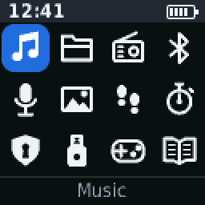

# Orpheus manual

Orpheus is a replacement firmware for the Yoton YM03 MP3 player. This
manual describes what it does today (state of 2026-11-27); parts that are
still being built are marked **in progress**. The day-to-day log of the
work is [STATUS.md](../STATUS.md).

## Getting started

* [Install, update and restore](install.md): putting Orpheus on the
  player, updating it, and going back to the original firmware.
* [Keys](keys.md): the ten keys mean the same thing on every screen.

## Apps

Every app below is on Home. **Works** means it has been used on the
player; **on the player, being checked** means it runs there and its
screens are tested automatically, but a person has not yet checked all of
what it does (the open checks are in [USER-CHECKS.md](../USER-CHECKS.md)).

| App | Page | What it does | State |
|---|---|---|---|
| Music | [music.md](music.md) | Folders, library by artist/album/genre, queue, shuffle, resume, bookmarks, MIDI files | Works |
| Now Playing | [now-playing.md](now-playing.md) | The playing track, its cover, views and options | Works |
| Files | [files.md](files.md) | Browse, sort, play, read text files | Works |
| Radio | [radio.md](radio.md) | FM radio with presets and scanning | Works; stereo and RDS being checked |
| Bluetooth | [bluetooth.md](bluetooth.md) | Send music to Bluetooth headphones or a speaker | Works; real headphones being checked |
| Recorder | [recorder.md](recorder.md) | Record from the microphone or the radio | On the player, being checked |
| Pictures | [pictures.md](pictures.md) | JPEG, PNG, BMP, GIF and QOI viewer and slideshow | Works |
| Steps | [steps.md](steps.md) | Step counter with a daily goal and a week's history | On the player, being checked |
| Stopwatch | [stopwatch.md](stopwatch.md) | Stopwatch, timer and alarm | On the player, being checked |
| Authenticator | [authenticator.md](authenticator.md) | One-time codes behind a PIN, typed over USB | On the player, being checked |
| USB Drive | [usb-drive.md](usb-drive.md) | Start a computer from an ISO or disk image on the card | Works; starting a real PC being checked |
| Games | [games.md](games.md) | Blocks, 4096, Solitaire, Salvo and Bricks | Works |
| Books | [books.md](books.md) | Read TXT, Markdown, FB2 and EPUB books | Works; known issues on the page |
| Settings | [settings.md](settings.md) | Sound, playback, display, power, radio, USB, accessibility and more | Works; exceptions on the page |

The **Sequencer** (a drum machine with synth tracks,
[sequencer.md](sequencer.md)) is built but not on the player yet; it runs
in the simulator and on the website's
[Try it](https://timschmidt.github.io/orpheus/try.html) page, hidden from
Home until a script command shows it (see its page).

## Also on the player

* [Power mode](power.md): how fast the processor runs, and what that
  costs in battery.
* [Accessibility](accessibility.md): larger text, high contrast, slower
  keys.
* [Screen reader](screen-reader.md): every screen read aloud, for use
  with the screen off.

## Planned

The Bluetooth presenter remote (slide clicker), the player as a USB sound
card for a computer, reading books aloud, and tools for the headphone
jack (signal generator, infrared remote). They are not on the player yet.

## When something goes wrong

* [Troubleshooting and recovery](troubleshooting.md): the player does not
  start, restarts by itself, or you want the original firmware back.
* [FAQ](faq.md)
