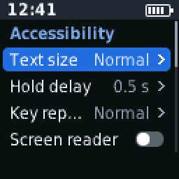
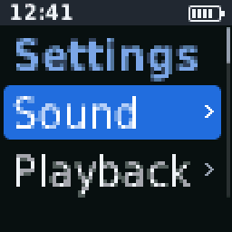
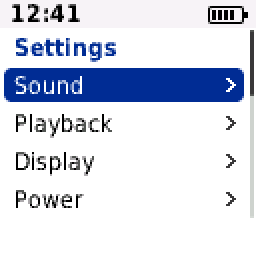

# Accessibility

Settings › Accessibility makes the text larger and the keys slower. Two
high-contrast themes, reduced motion and a click for held keys are in
Display and Sound; this page covers them too. The spoken side has its own
page: [screen reader](screen-reader.md).

## Settings › Accessibility

| Setting | Choices | Does |
|---|---|---|
| **Text size** | Normal, Large, Extra large | Large uses a 16 px font; Extra large doubles the normal font. Lists show five, four or three rows |
| **Hold delay** | 0.5 s (at first), 0.75 s, 1 s, 1.5 s, 2 s | How long a key must stay down to count as held |
| **Key repeat** | Normal, Slow, Slower | How fast a held key repeats: Normal 8 a second rising to 30, Slow 4 rising to 10, Slower a steady 2 a second |

The rows after these belong to the [screen reader](screen-reader.md).

## Text size

Large and Extra large apply to lists, menus, dialogs, the bottom row and
Now Playing. A dialog's title may take two lines. Now Playing drops the
cover and shows the title across the whole width. Prev and Next page by
the rows the screen shows.

These stay the same size: the status bar, big numbers, games, pictures,
Books (it has its own font size), Steps, the Authenticator, the Equaliser,
the lock and charging screens, and lists a screen draws itself (Up next,
the Authenticator's codes, alarms).

## Hold delay and key repeat

The hold delay applies to every hold: Back for Home, Menu for Quick
settings, OK on Now Playing. The power menu needs 1.5 s, or the hold delay
when that is longer; holding Power for 4 s still switches the player off.
See [keys](keys.md).

## High contrast

Settings › Display › Theme has **White on black** and **Black on white**.
All text is drawn at a contrast of at least 7:1; the accent colour setting
is ignored. In the Dark and Light themes the value in a highlighted row is
fainter; choose a high-contrast theme if it is hard to read.

## Reduced motion

Switch off Settings › Display › Animations. Long names no longer scroll,
the busy spinner is a still ring, and the Recorder's pause dot and the
alarm's icon stay lit instead of blinking. Battery saver does the same.
The screen saver's clock still moves once a minute (against burn-in), and
games keep their own motion (4096 has its own Animations setting).

## Key click for holds

Settings › Sound › Key click: Off, Presses, or **Presses and holds**. With
Presses and holds a held key clicks a second time when it reaches the hold
delay, so you know the hold counted. There are no clicks while the Recorder
records from the microphone.

## State

In the player's firmware. On the player, the automated test suite checked
Hold delay, Text size Large and the hold click. Nobody has yet gone through
these settings by hand on the player; that check is open. See also
[Settings](settings.md).
