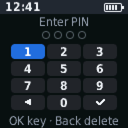
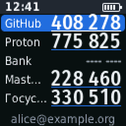
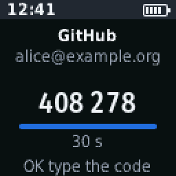

# Authenticator

Authenticator shows one-time sign-in codes (time-based TOTP and
counter-based HOTP) from an encrypted vault behind a PIN, and types them
into a computer over USB.

**The PIN stops casual use, not someone with the player and a cable**,
who can copy the flash and try every PIN. See
[SECURITY.md](../../SECURITY.md).

## The PIN

The first time, a note says so; then choose a PIN of 4–8 digits and
enter it again.



| Key | Does |
|---|---|
| **Up / Down / Prev / Next** | Move over the pad |
| **OK** | Press the key (◂ deletes, ✓ finishes) |
| **Hold OK** | Finish |
| **Back** | Delete a digit; with none, leave |

After a wrong PIN the pad waits: 1 s, doubling each time, up to 5
minutes. The vault locks when you leave with Back, when the screen goes
off and after 60 s without a key.

## Adding accounts

Put one `otpauth://` line per account (most sites show it under "can't
scan the code?") into `/.orpheus/otp-import.txt` on the card, then
**Menu › Import from card**:

```
otpauth://totp/Example:alice@example.org?secret=JBSWY3DPEHPK3PXP&issuer=Example
```

Blank lines and lines starting with `#` are skipped; HOTP lines need
`counter=`. If every line was added or already there, the file is
overwritten with zeros and deleted ("File deleted"; the card may keep old
copies). Otherwise it stays ("File kept") with a count of lines not
understood. The vault holds 32 accounts. The developer tools can also
send an account over USB; the player asks "Add this account?".

## Codes



Each row shows the account and its code; a bar under the code shrinks
with the seconds left, red in the last 5.

| Key | List | Big code |
|---|---|---|
| **OK** | Show the big code | Type it |
| **Up / Down** | Choose an account | Previous / next account |
| **Back** | Lock and leave | Back to the list |

An HOTP account shows dashes until **Menu › Next code**. Time-based codes
need the clock: while it is not set the list says "Clock not set" and
shows dashes. Set the time and time zone in [Settings](settings.md) ›
Date and time, or from a computer.



## Typing a code

Connect the player, focus a text field on the computer, and press OK on
the big code: the player becomes a USB keyboard and types the digits.
It cannot type while the computer has the card as a drive. Settings ›
USB: **Keyboard layout** (the computer's: US, UK, German, French),
**Digits from keypad**, **Enter after code** (on).

## Menu

Import from card, Move up / down, Delete…, Time check (the clock's date
and time), Change PIN, Lock, Wipe vault… (deletes every account). If the
app says "Vault damaged", wipe it and import again.

## What has been tested

The app is on Home, its PIN screen opens on the player in the automatic
tests, and typing over the USB keyboard works on the player. Signing in
to a real site with a typed code has **not been checked yet** (user check
24 in [USER-CHECKS.md](../USER-CHECKS.md)).

## Not yet

**In progress**: adding an account by hand on the player, renaming, a
passphrase instead of a PIN (the only protection against a copied flash).
