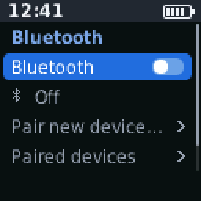
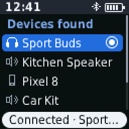
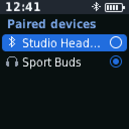

# Bluetooth

The YM03 has a Bluetooth **transmitter**: it sends your music to Bluetooth
headphones, earbuds or a speaker. It cannot receive audio from a phone;
that is a limit of the module in the player, not of Orpheus.

## Connect headphones the first time

1. Home › **Bluetooth**, highlight **Bluetooth** and press OK to switch it
   on. The line under it says "Starting…", then "Not connected".
2. Put the headphones in pairing mode (see their manual).
3. **Pair new device…**: the player searches and lists what it finds,
   with an icon for headphones, speakers, phones and computers.
4. Highlight the headphones and press OK. "Connecting…" turns into
   "Connected · name".

Play music as usual: the module sends what the player plays. Bluetooth
can also be switched on and off from Quick settings (hold Menu).

## Later

* With **Reconnect** on (the default), switching Bluetooth on connects to
  the last device by itself.
* **Paired devices** lists the devices the module remembers. OK on one
  connects to it; **Menu** offers Connect or Disconnect, and **Forget**.
* Switch Bluetooth off when you do not use it: the module is off whenever
  Bluetooth is off, and the player switches it off when it powers down.

## Volume

The volume keys set the player's own volume, and the headphones get that
level. The headphones' own volume buttons may or may not change the
level, depending on the headphones.

## What has been tested

Connecting, automatic reconnect and sending music were tested on the
player with a computer acting as a Bluetooth speaker. Tests with real
headphones are **in progress** (user check 17 in
[USER-CHECKS.md](../USER-CHECKS.md)); if yours do not connect or sound
wrong, please [report it](../../CONTRIBUTING.md#reporting-a-bug).

## Not yet

**In progress**: track titles shown on the headphones, the Bluetooth
presenter remote (slide clicker), editing the device name.
