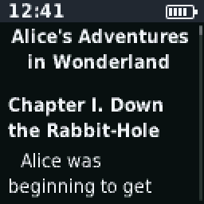
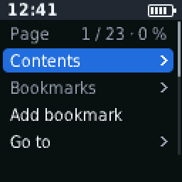
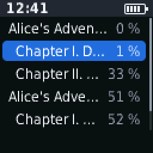
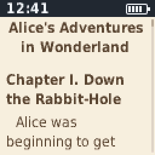

# Reading a book

How to turn pages, find your way and change how a book looks in
[Books](books.md). The text is laid out again to fit the screen and the
settings; a bar at the right edge shows where you are in the book.

## Keys

| Key | Press | Hold |
|---|---|---|
| **Next / Prev** | Next / previous page | Next / previous chapter |
| **Down / Up** | One line on / back | Repeat |
| **OK** | The reader menu | |
| **Menu** | Add bookmark, Contents, Bookmarks, Go to | Quick settings |
| **Back** | Close the book; its place is kept | Home |

The place is saved when you close the book, open another, switch the
player off, and every 16 page turns. At the last page Next shows "End of
the book".

## Reader menu

| Entry | What it does |
|---|---|
| Page | Page number, pages in all (once they are counted) and per cent read |
| Contents | The book's chapters with the per cent where each starts; OK goes there |
| Bookmarks | Your bookmarks: first words and per cent; OK goes there, Menu deletes one |
| Add bookmark | Marks the top line of the page (12 per book) |
| Go to | A per cent of the book: Prev/Next 10 %, Up/Down 1 %, OK jumps |
| Reading settings | Below |
| Read aloud | Greyed out: **in progress** |

A jump far into a new book may wait a moment until the pages up to there
are counted.

## Reading settings

They are at the end of the reader menu, apply to every book and change the
page at once.

| Setting | Choices (default) |
|---|---|
| Font size | Small, Medium, Large, Extra large (Small) |
| Margins | Narrow, Normal, Wide (Normal) |
| Spacing | Tight, Normal, Relaxed (Normal) |
| Justify | Even right edge, on or off (off) |
| Palette | Theme (the player's theme), Light, Dark, Sepia (Theme) |
| Auto page turn | Off, 10, 20, 30, 60 s (Off) |

Where the book is read from (the Books folder or the whole card) is set
in the library's Menu (see [Books](books.md)). Other display settings,
such as brightness, are in [Settings](settings.md); the keys are on
[Keys](keys.md).
