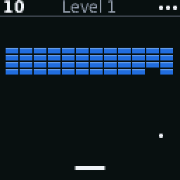
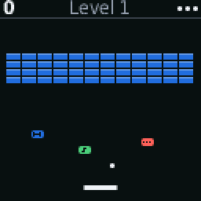

# Bricks

A brick breaker, one of the [Games](games.md): keep the ball in play with
the paddle and break every brick to clear the level. The top line shows
the score, the level and the lives left.

## Keys

| Key | Does |
|---|---|
| **Prev / Next** (or **Down / Up**) | Move the paddle, faster while held |
| **OK** or **Menu** | Launch the ball |
| **Back** | Pause |

A new game starts with the ball on the paddle: **OK to launch**. Where the
ball meets the paddle sets its way: the middle sends it nearly straight
up, the ends off to the side. The ball speeds up a little as the level
goes on.

## Bricks and levels

Bricks take one, two or three hits and fade as they wear; grey bricks
never break. A brick scores 10 for each hit it took, a cleared level 100.
The first eight levels are hand-made; after them (or from the start, with
the Levels setting) they are generated, fuller and harder as you go.

## Capsules

Some bricks drop a capsule; catch it with the paddle.

| Sign | Does |
|---|---|
| A bar | Wider paddle, until you lose a life or clear the level |
| **S** | Slower ball |
| Three dots | Splits the ball into three |
| **C** | For 20 s the paddle holds the ball; OK lets it go |
| **+** | An extra life (nine at most) |

## Settings

In the pause menu's Settings; Steering applies at once, the others from
the next game.

| Setting | Choices (default) |
|---|---|
| Start level | 1–10 (1) |
| Ball | Slow, Normal, Fast (Normal) |
| Paddle | Small, Medium, Large (Medium) |
| Lives | 1, 3, 5 (3) |
| Power-ups | On or off (on) |
| Levels | Hand-made (the eight again, with a hit more per brick), Generated, Mixed (Mixed) |
| Steering | How fast the paddle moves: Slow, Normal, Fast (Normal) |

The game in progress is saved like the other games; a game continued in
the middle of a rally waits for OK before the ball moves.
