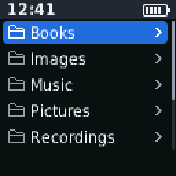
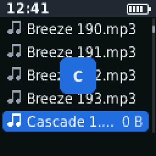
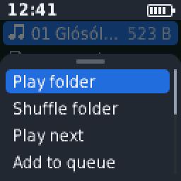

# Files

A browser for everything on the microSD card. Folders come first, then
files, in natural order ("Track 2" before "Track 10"), ignoring case.

## What OK does

| On | OK |
|---|---|
| A folder | Opens it |
| A music file | Plays it; the rest of the folder becomes the queue |
| A picture (JPEG, PNG, BMP, QOI, GIF) | Opens it in the [picture viewer](pictures.md) |
| A text file (`.txt`, `.lrc`, `.cue`, `.md`, `.log`) | Opens it in the text viewer |

The **text viewer** wraps words to the screen; Prev and Next turn pages,
and it remembers where you were.

## Moving fast

* **Prev / Next** turn a page of the list.
* **Hold Prev or Next** in a long list to jump by first letter: the letter
  shows large in the middle while you hold.
* Large folders open at once. The first visit lists names in the order
  they are stored and sorts them in the background; the sorted order is
  kept in `/.orpheus/cache/` on the card, so the next visit is sorted
  immediately.

## Menu

| Entry | What it does |
|---|---|
| Play folder / Shuffle folder | Plays the whole folder as the queue |
| Play next | Puts the file after the current track |
| Add to queue | Puts it at the end of the queue (256 songs at most) |
| Properties | Size and date; tags for music files |
| Sort | Name, Date or Size |
| Show hidden | Shows dot-files, `System Volume Information` and `/.orpheus` |
| Card info | Capacity, free space, file system |

**In progress**: Rename, Delete, New folder and Add to playlist. Until
they exist Orpheus does not change your files: it writes only inside
`/.orpheus/` on the card.

## Cards

FAT32 and exFAT cards work. If there is no card, Music, Files and Pictures
say so and the rest of the player keeps working.

While the player is a card reader for a computer (Settings › USB, or the
dialog when you plug it in), the card belongs to the computer and Files is
not available; eject it on the computer before you unplug.
