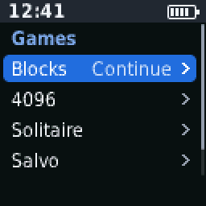
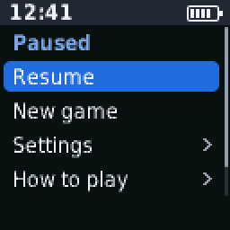
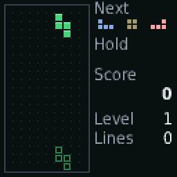
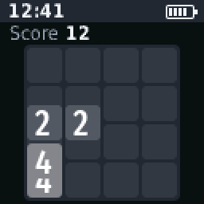
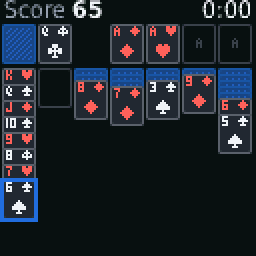

# Games

Five games of our own: Blocks, 4096, Solitaire, [Salvo](salvo.md) and
[Bricks](bricks.md). Music keeps playing while you play. All five have
been played by hand on the player and work.

## The list

A row shows **Continue** when that game is saved, otherwise your best
result under the current settings. OK continues or starts a new game.

## Pause menu

**Back** pauses and opens the game's menu:

| Entry | What it does |
|---|---|
| Resume | Back to the game |
| New game | Starts again; asks first while a game is in progress |
| Settings | The game's settings, remembered per game |
| How to play | Rules and keys |
| Best | Your best under the current settings |
| Quit | Saves and goes back to the list |

A game also pauses when the screen goes off or another screen covers it,
and waits for **OK to continue**. Settings that change the rules apply
from the next game ("From the next game"); the others at once.

## Saves and scores

The game in progress is saved when you pause or quit, when you switch the
player off, and before the card goes to a computer over USB; it survives a
restart. When a game ends its save is removed and the result goes into the
score table, kept per game and per combination of rule settings. Files are
in `/.orpheus/games/` on the card. Opening or quitting a game while music
plays causes no dropouts (measured on the player).

## Blocks

Pieces of four squares fall into a 10 × 20 well; full rows go, and the
level rises every ten rows. A game opens paused: **OK to start**.

| Key | Does |
|---|---|
| **Prev / Next** | Move |
| **Up / OK** | Turn clockwise / the other way |
| **Down** | Drop faster; hold to drop at once |
| **Menu** | Put the piece aside, or bring it back |

Settings: Mode (Endless, 40 lines, 2 minutes), Start level, Pieces (Bag of
7, Random), Ghost piece, Previews (0–3), Hold piece, Lock delay, Shift and
Repeat (how a held Prev or Next moves the piece), Wall kicks.

## 4096

**Up, Down, Prev** and **Next** slide every tile; two equal tiles join
into one of twice the value. Reach the goal tile to win, then keep going if
you like. **OK** takes back a slide.

Settings: Board (4 × 4 to 6 × 6), Goal tile (2048, 4096, 8192, Endless),
Chance of 4, Undo steps (0–3), Animations.

## Solitaire

Klondike: build four suit piles from ace to king; in the seven columns a
card goes on one higher of the other colour, and only a king fills an
empty column.

**Prev / Next** move between piles, **Up / Down** take more or fewer cards
of a column, **OK** picks up and puts down (on the stock: turns cards
over), **hold OK** takes back a move, **Menu** sends cards to the suit
piles, **Back** puts held cards back.

Settings: Draw (one or three cards), Passes (Unlimited, 3, 1), Scoring
(Standard, Casino, None), Auto-move, Auto-complete, Show timer, Winnable
only (best effort).

## Not yet

**In progress**: sound effects over the music, and names in the score
table.
