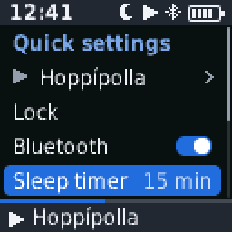
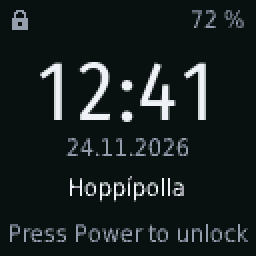

# Keys

The YM03 has ten keys: **Up**, **Down**, **Prev**, **Next**, **OK** (the
play key), **Menu**, **Back**, **Vol+**, **Vol−** and **Power**. Each key
means the same thing on every screen. A screen may leave a key unused, but
never gives it a different meaning.

**Hold** means: keep the key down for half a second. Power has its own
times (below).

| Key | Press | Hold |
|---|---|---|
| **Up / Down** | Move the highlight (in lists, past the end round to the other end: Settings › Display › List roll-around); change a value in an editor | Repeat, faster after a second; stops at the end of a list |
| **Prev / Next** | Lists: page up / page down. Now Playing: previous / next track | Lists: jump by first letter. Now Playing: seek |
| **OK** | Open or start the highlighted item. Now Playing: play / pause | Now Playing: stop |
| **Back** | Up one level; closes menus and dialogs | Go to Home |
| **Menu** | Options for this screen (always a list) | Quick settings |
| **Vol+ / Vol−** | Volume, on every screen, also with the screen off | Keeps changing |
| **Power** | Screen off and keys locked; press again to wake | 1.5 s: power menu. 4 s: power off |

## Rules you can rely on

* **Back never starts anything**, and it never throws away something you
  typed without asking.
* **Music keeps playing** when you leave Now Playing or open another app.
  Only stopping it, starting something else, or switching the player off
  stops it.
* While something plays and you are not on Now Playing, the bottom row is a
  small player showing the title.
* **Hold Back** from anywhere to get Home. **Hold Menu** from anywhere for
  Quick settings: Now Playing, Lock, Bluetooth on/off, Output and more.
* Destructive actions (factory reset) ask first, with the safe answer
  highlighted.

## Home

Home is a grid of app icons. Up, Down, Prev and Next move the highlight;
OK opens the app. The bottom row names the highlighted app, or shows the
small player while music plays. Settings › Display › Home screen chooses
which apps appear.

## Screen off and lock

Press **Power** to switch the screen off and lock the keys; music keeps
playing and the volume keys still work. Press any key to see the lock
screen (clock, date, track, battery) and **Power** to unlock.

## Power menu

Hold **Power** for 1.5 s: Power off, Sleep timer, Lock keys, Restart, and
under it two entries for the curious: Start original firmware and Recovery
mode. **Start original firmware** does nothing useful on a player with the
current layout (the original firmware is no longer there).
**Recovery mode** restarts into the chip's USB recovery mode, used by the
install tools ([troubleshooting](troubleshooting.md)).

Holding **Power** for 4 s switches the player off without the menu. To
switch it on again, hold Power for about a second or plug in USB.
