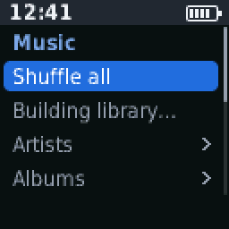

# Music

Music finds your songs on the microSD card two ways: by **folder** (works
at once) and through a **library** of artists, albums and genres that the
player builds in the background.

## The list

| Entry | What it does |
|---|---|
| Now Playing | Back to the playing track (only while there is a queue) |
| Resume "title" | Continue where you stopped, after switching off |
| Shuffle all | Plays up to 256 songs from the whole card in random order |
| Artists, Albums, Songs, Genres | The library (below) |
| Recently added | Songs by the date they arrived on the card |
| Folders | The card's folders, music files only |
| Bookmarks | Places you saved in long files |

OK on a song plays it, and the list it is in becomes the **queue** (the
rest of the album or folder, in list order). OK on an artist, album or
folder opens it. **Menu** on any of them: Play, Shuffle, Play next, Add to
queue (up to 256 songs).

## The library

The first time the player sees a card (or after you add music) it reads
the tags of every file while you use it; until it is done the library
entries show "Building library…" and Folders and Shuffle all still work.
On a card with about 5,700 files the first build took about 11 minutes;
later builds only read what changed. Settings › Storage › Rebuild library
starts over.

Files without tags show up as "Unknown artist", and albums take the folder
name. The library is kept on the card in `/.orpheus/`; nothing else on the
card is changed.

## Playing

* **Formats**: MP3, FLAC, WAV, Ogg Vorbis, Opus and Speex, and MIDI
  files (below). AAC, ALAC, WavPack and APE are **in progress**.
* **Gapless**: consecutive tracks join without a gap. MP3 joins are clean;
  the first FLAC join after a queue starts can tick (known issue).
* **Resume**: the player remembers the queue and the position when it is
  switched off or restarted, and opens that track paused at the same
  place (Settings › Playback › Resume at start-up).
* **Shuffle and repeat**: Settings › Playback, or Menu on Now Playing.
* **A–B repeat** and the **sleep timer**: Menu on Now Playing.
* Browsing while music plays does not interrupt it (measured: no dropouts
  while scrolling a large folder during 48 kHz MP3 playback).

What the player shows while playing is on [Now Playing](now-playing.md).

## MIDI files

`.mid`, `.midi`, `.kar` and `.rmi` files play from Music and Files like
any other song, with pause and seek. The player's own synthesiser plays
them with the project's own General MIDI sound set (32 sounds shared by
the 128 instruments), so they sound different from a computer or a
keyboard. A heavy file makes the player run its processor
faster (up to 288 MHz in [Automatic](power.md)); if even that is not
enough, it leaves out the effects (chorus, delay, reverb) and then some
notes rather than stop. The lyrics of `.kar` files show in the
simulator; on the player that view is **in progress**.

## Not yet

**In progress**: playlists (`.m3u`), Favourites, fades on skip, playback
speed (hidden until it is built).
