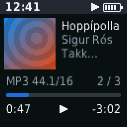
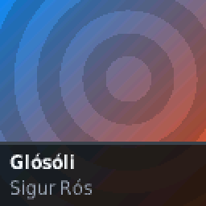
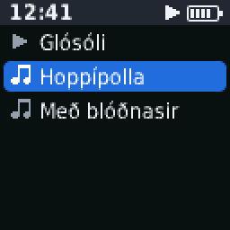
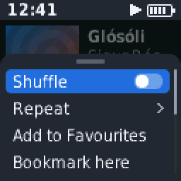

# Now Playing

The screen of the playing track: cover, title, artist, album, format,
position in the queue, and time.

## Keys

| Key | Press | Hold |
|---|---|---|
| **OK** | Play / pause | Stop |
| **Next** | Next track | Seek forward, faster the longer you hold |
| **Prev** | Back to the start of the track; within its first 3 s, the previous track | Seek back |
| **Up / Down** | Change the view | |
| **Menu** | Options (below) | Quick settings |
| **Back** | Leave; the music keeps playing | Home |

## Views

Up and Down cycle through the views; the player remembers your choice.

| View | Shows |
|---|---|
| Standard | Cover, tags, format, progress |
| Big art | The cover over the whole screen; the text appears for 3 s after a key |
| Up next | The queue. OK jumps to a track; Menu removes or moves it |
| Details | Codec, bit rate, sample rate, channels, file |
| Lyrics | The words in time, from an `.lrc` file beside the song or a `.kar` file: in the simulator and the browser; **in progress** on the player (empty there) |
| Levels | **In progress** (empty on the player) |

**Covers** come from a picture embedded in an MP3 or FLAC file, or from a
picture named like `cover`, `folder` or `front` in the track's folder. The player makes a small copy the first time and keeps it in
`/.orpheus/cache/art` on the card. Making that copy can cause a short
dropout at the start of a track (known issue).

## Menu

* **Shuffle**, **Repeat** (off, one, all)
* **Bookmark here**: saves the position; Music › Bookmarks lists them
* **A–B repeat**: set A, set B, clear
* **Equaliser…**, **Sleep timer…**
* **Go to album / artist** (songs from the library), **Go to folder**
* On a track in Up next: **Remove from queue**, **Move up**, **Move down**

Speed is hidden until it is built. **Add to Favourites** and **Delete
file** are listed but **in progress**.

## Sound

Volume works on every screen. The equaliser (presets and a 5-band custom
curve), balance, bass, crossfeed and channel mode are in Settings › Sound
and apply while you listen.
