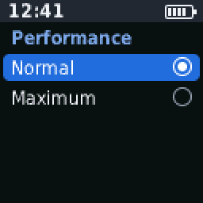

# Performance (Settings › System › Performance)

The player changes its processor speed by itself: slow while it waits for
you, faster while it decodes music or draws a busy screen. **Performance**
chooses how far it may go.

| Setting | Fastest speed | Core voltage | Use it for |
|---|---|---|---|
| **Normal** (default) | 144 MHz | 1.0 V | Everything. Every codec the player supports plays at this speed |
| **Maximum** | 288 MHz | 1.3 V | Work that still stutters at Normal (for example several Sound effects at once on a demanding file). Busy screens may feel quicker |

With **Maximum** the player only goes to 288 MHz when it is busy (the same
rule that takes it from 96 to 144 MHz at Normal), and it comes back down
after three quiet seconds. It does not stay at full speed while idle or
switched off.

**Battery**: 288 MHz needs a higher core voltage, so while the player
runs at that speed it uses more power. How much shorter a charge lasts is
being measured (it depends on how often the player is busy); until then,
keep Normal unless something does not play smoothly. 288 MHz and 1.3 V are
values the original firmware uses itself, so Maximum does not run the chip
outside what it was built for.

Opus files are limited by reading the program from flash memory, not by the
processor: Maximum does not make them play.

The setting is kept when the player is switched off. Factory reset sets it
back to Normal.
