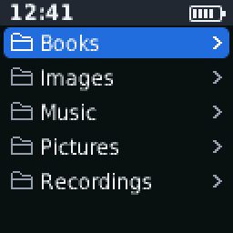
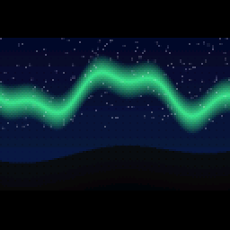

# Pictures

Pictures lists the card's folders and the pictures in them, and shows one
picture at a time over the whole screen.

## Formats

JPEG (baseline and progressive), PNG, BMP, GIF (the first frame) and QOI.
Large pictures are scaled down while they load: a 1600 × 1200 JPEG takes a
moment and then fits the 128 × 128 screen with bars at the sides.
A damaged file shows "Cannot show this picture" instead of stopping.

## Keys in the viewer

| Key | Does |
|---|---|
| **Prev / Next** | Previous / next picture in the folder (other files are skipped) |
| **Up / Down** | Rotate by 90° |
| **OK** | Fit the whole picture, or fill the screen |
| **Menu** | Slideshow on/off, slideshow interval, rotate left/right |
| **Back** | Back to the list |

## While music plays

Pictures and music share one block of memory. While a track is loaded
(playing or paused) the viewer says "Stop playback to view pictures" and
shows the picture by itself once playback stops. Album covers on
[Now Playing](now-playing.md) are not affected.

Pictures also open from [Files](files.md).

## Not yet

**In progress**: a thumbnail grid, zoom to 100 % with panning, remembering
the rotation of each picture, using a picture as wallpaper, delete, and
animated GIF.
