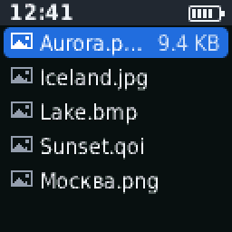

# Pictures

Pictures opens at the card's pictures folder and lists only folders and
pictures: music, books and other files are left out. It shows one picture
at a time over the whole screen.

## Which folder it opens

The first of these folders on the card: `/Pictures`, `/Photos`, `/DCIM`
(a camera's folder). Upper or lower case does not matter (`/PICTURES` is
`/Pictures`). A card with none of them opens at its top level.

OK on a folder goes into it and Back comes out again; **Back from the
pictures folder goes to Home**. To browse the rest of the card, use
[Files](files.md): it opens pictures in the same viewer.

## Formats

JPEG (baseline and progressive), PNG, BMP, GIF (the first frame) and QOI.
Large pictures are scaled down while they load: a 1600 × 1200 JPEG takes a
moment and then fits the 128 × 128 screen with bars at the sides.
A damaged file shows "Cannot show this picture" instead of stopping.

## Keys in the viewer

| Key | Does |
|---|---|
| **Prev / Next** | Previous / next picture in the folder (other files are skipped) |
| **Up / Down** | Rotate by 90° |
| **OK** | Fit the whole picture, or fill the screen |
| **Menu** | Slideshow on/off, slideshow interval, rotate left/right |
| **Back** | Back to the list |

In the list, **Menu** has Slideshow (from the focused picture),
Properties, Delete…, Sort by, Show hidden and Card info.

## While music plays

Pictures and music share one block of memory. While a track is loaded
(playing or paused) the viewer says "Stop playback to view pictures" and
shows the picture by itself once playback stops. Album covers on
[Now Playing](now-playing.md) are not affected.

## Not yet

**In progress**: a thumbnail grid, zoom to 100 % with panning, remembering
the rotation of each picture, using a picture as wallpaper, delete in the
viewer, and animated GIF.
