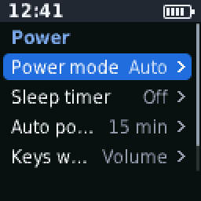

# Processor speed and Power mode (Settings › Power › Power mode)

The player chooses its processor speed by itself, between 24 MHz and
288 MHz. **Power mode** says what it aims for.

| Power mode | Speed | Use it for |
|---|---|---|
| **Automatic** (default) | The cheapest speed that keeps up with what the player is doing: 24 MHz when it waits for you, faster while it decodes music, draws a busy screen or plays MIDI, up to 288 MHz when nothing slower keeps up | Everything |
| **Battery saver** | Always the slowest speed at which the card, the screen, the sound and the keys work (24 MHz; 48 MHz while a USB cable is connected) | The longest battery life. Some files may stutter or stop ("too slow for this player"), MIDI may lose instruments and screens open more slowly |
| **High performance** | Always 288 MHz | The quickest screens. It uses the most power, also while idle or with the screen off |

At 288 MHz the processor needs a higher core voltage (1.3 V instead of
1.0 V). 288 MHz and 1.3 V are values the original firmware uses itself and
the chip's rated maximum; the player never goes beyond them. In
Automatic the player goes there only when the work needs it and comes back
down a few seconds after.

How much each mode changes the battery life is **being measured**.

Battery saver also stops scrolling text (as Animations off).

The setting is kept when the player is switched off. Factory reset sets it
back to Automatic.
