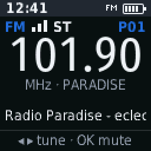
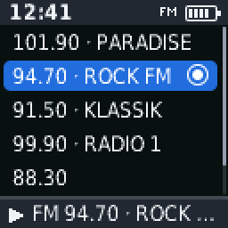
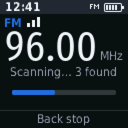

# Radio

Radio plays FM stations through wired earphones (not over Bluetooth). It
shows the frequency, signal bars, "ST" for stereo, the preset number and
the station's RDS name and text.

## The earphones are the antenna

The earphone cable is the radio's antenna, so **wired earphones must be
plugged in**. Without them the screen says "Plug in earphones: the cable
is the antenna"; tuning still works, but you will hear little.

## Start and stop

Home › **Radio** starts the radio at the last frequency. Starting the
radio stops the music, and playing music stops the radio. **Back** leaves
the app and the radio keeps playing ("FM" in the status bar).

## Keys

| Key | Does |
|---|---|
| **Prev / Next** | One step down / up |
| **Hold Prev / Next** | Seek to the previous / next station |
| **Up / Down** | Previous / next preset |
| **OK** | Mute and unmute; starts the radio when it is off |
| **Hold OK** | Radio off |
| **Volume** | Radio volume |

While a seek or an auto-scan runs, Prev or Next stops it; during a scan
Back stops it too. See also [keys](keys.md).

## Menu

| Item | Does |
|---|---|
| **Save preset** / **Remove preset** | Adds the station to the presets ("Saved · P03"), or removes it |
| **Presets…** | The presets list |
| **Auto-scan** | Finds the stations and makes them the presets |
| **Force mono** | Plays every station in mono |
| **Region** | Europe, United States, World, Japan, Wide band |
| **Stop radio** | Radio off |

## Presets

Up to 30, each with its frequency and the station's RDS name (taken the
first time the station is heard); the one playing is marked. OK tunes and
goes back; Menu offers **Move up**, **Move down** and **Remove preset**.

**Auto-scan** ("Scanning… 3 found") keeps the 30 strongest stations,
strongest first, and tunes to the first. With presets it asks "Replace
presets?" first. A note gives the number found; if none, your presets
stay.

## Region

| Region | Band | Step |
|---|---|---|
| Europe | 87.5–108 MHz | 100 kHz |
| United States | 87.9–107.9 MHz | 200 kHz |
| World | 87.5–108 MHz | 50 kHz |
| Japan | 76–95 MHz | 100 kHz |
| Wide band | 65–108 MHz | 100 kHz |

Tuning wraps around at the ends of the band. Region, Force
mono and **Seek sensitivity** (how strong a station must be for a seek or
scan to stop) are also in [Settings](settings.md) › Radio. With
Settings › Date & time › **Set from radio (RDS)** on, stations that send
the time set the clock.

## What has been tested

On the player the tuner works (a scan found 13 local stations), the
Radio app runs with the same screens as the simulator, and a station and
region have been stored by hand. Stereo, RDS text and how the radio
sounds have not yet been checked by a person (user check 20 in
[USER-CHECKS.md](../USER-CHECKS.md)).

## Not yet

**In progress**: renaming presets, and a Record item in the Radio menu
(use the [Recorder](recorder.md) with Source: FM radio).
