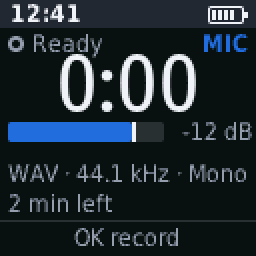
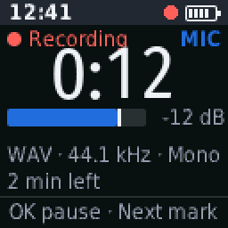
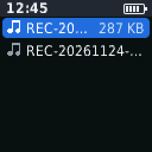

# Recorder

Recorder records from the built-in microphone or the FM radio to files
in `/Recordings` on the card. It needs a card.

## The screen

While the app is open the level meter runs, so you can check the level
before you start. The top line shows the state (Ready, Recording, Paused,
Waiting for sound) and the source (MIC, or FM with the frequency); below
are the time, the meter with its peak in dB (red when it clips), the
format and how much recording time the card has left. If the card could
not keep up, "N dropped" appears instead; the gaps are marked in WAV
files.

## Keys

| Key | Does |
|---|---|
| **OK** | Start; while recording, pause and resume |
| **Next** | A mark (a cue point in WAV files) |
| **Up / Down** | Input gain, −12 to +12 dB (only with Automatic gain off) |
| **Hold OK** or **Back** | Asks "Stop recording?" |
| **Back** (not recording) | Leave the app |

Recordings are always saved, also when the card fills up ("Card full ·
recording saved"); a note names the file. Starting a recording stops the
music. See also [keys](keys.md).

## Menu

| Item | Choices |
|---|---|
| **Source** | Microphone (mono), FM radio (stereo) |
| **Format** | WAV (16-bit), WAV ADPCM (about a quarter of the size), FLAC (lossless) |
| **Quality** | Voice (16 kHz), Standard (44.1 kHz), High (48 kHz) |
| **Automatic gain** | On (the default) keeps the level even; off, Up/Down set it |
| **Voice activation** | Off, −50, −40, −30 dB: writes only while the sound is above the level, and 2 s after |
| **Auto split** | Off, 15, 30, 60 min: then a new file starts |
| **Monitor in headphones** | No effect yet |
| **Low-cut filter** | Cuts rumble below about 100 Hz |
| **Recordings…** | The list below |

While recording the menu has **Stop**, Automatic gain, Voice activation
and Low-cut filter. With voice activation the screen says "Waiting for
sound" in quiet passages and the time stops. Choosing FM radio starts the
radio, which keeps playing while it records. The same settings, and the
folder, are in [Settings](settings.md) › Recording.

## Files

`/Recordings/REC-20261124-153012.wav` (date and time), or
`FM-101.90-20261124-153012.wav` from the radio; `REC-0001.wav` and up
while the clock is not set. FLAC files end in `.flac`. The file's header
is updated every 10 seconds, so a sudden power loss costs at most the
last 10 seconds.

## Recordings

Recorder › Menu › **Recordings…** lists `/Recordings`, newest first. OK
plays one in [Now Playing](now-playing.md). Menu offers **Play folder**,
**Properties** and **Delete…**, which asks "Delete this file?" first.

## What has been tested

On the player, recording from the microphone works (levels measured,
WAV files written), and Recordings lists `/Recordings` and deletes after
the question. Listening to the recordings and recording from the radio
have not yet been checked by a person (user check 25 in
[USER-CHECKS.md](../USER-CHECKS.md)).

## Not yet

**In progress**: voice formats (Opus, Speex), MP3, listening while
recording (Monitor), pre-record, a mark that starts a new file, and
renaming recordings.
