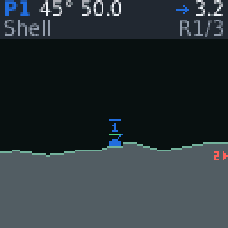
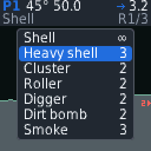
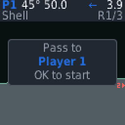

# Salvo

An artillery duel, one of the [Games](games.md): two to four tanks take
turns to shoot at each other across a landscape, and the last tank
standing wins the round. Each tank is played by a person or by the
computer.

The top lines show whose turn it is, the barrel's angle and the power, the
wind (an arrow and its speed in m/s), the weapon and the round.

## Keys

| Key | Does |
|---|---|
| **Up / Down** | Turn the barrel (hold to go faster) |
| **Prev / Next** | Set the power (hold to go faster) |
| **OK** | Fire; during a shot, speed it up |
| **Hold OK** | See the whole world at once |
| **Menu** | Weapon list (OK chooses; Back or Menu closes it) |
| **Hold Prev / Next** | During a shot or the computer's turn: look around |
| **Back** | Pause; a shell in the air lands first |

## How it plays

Shells fly through real air: the gravity of the world you chose, drag
that grows with speed, and a wind that changes every turn and pushes light
shells more than heavy ones. Blasts cut craters, the earth above falls in,
and tanks fall and slide; a long fall hurts.

Weapons: shell, heavy shell, cluster (splits into three at the top),
roller (rolls downhill), digger (cuts a trench), dirt bomb (a mound for
cover) and smoke (shows the wind). Points come from damage dealt, tanks
destroyed (50) and rounds won (100). Between rounds, credits buy weapons
in the shop.

When two or more people play, each person's turn starts with **Pass to
Player n**, so you can hand the player over. The computer aims by trying
shots with the same physics and a guess at the wind, and corrects from
its last shot; harder players guess better.

## Settings

The pause menu's Settings has three groups. Only Aim guide applies at
once; the rest from the next game.

| Group | Settings (default) |
|---|---|
| Players | Players 2–4 (2); Player 1–4: Human, Novice, Easy, Hard or Expert (Player 1 Human, the others Easy); Rounds 1, 3, 5, 10 (3); Turn timer Off, 15, 30, 60 s (at 0 the tank fires as aimed) |
| World | Terrain: Hills, Mountains, Canyon, Islands, Plateaus, Mixed (Hills); Roughness and Height range: Low, Medium, High (Medium); Terrain seed (0: a new landscape every game); World width 128–384 px (256); Gravity: Moon, Mars, Earth, Jupiter (Earth); Wind: None, Light, Strong, Custom (Light); Custom wind 1–30 m/s; Gusts (off); Air drag: Off, Realistic, Heavy (Realistic) |
| Rules | Tank health 50–200 (100); Fall damage (on); Weapons: Shells only or All seven (All seven); Shop (on); Aim guide: None, Last shot, Preview (Last shot) |

Worlds wider than the screen scroll: the view follows the shell or the
tank whose turn it is, and tanks out of view show as their number at the
edge.
