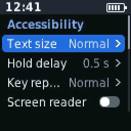
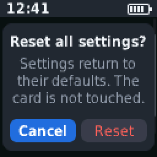

# Screen reader

The screen reader speaks what the screen shows: the screen's name, the
highlighted item, its value and its place in the list. It speaks English
only, whatever the language setting.

## On and off

Press **Back** and **Menu** together and hold both for 2 s, on any
screen, even locked or with the screen off. A rising tone and
"Screen reader on" confirm it; the same keys again give "Screen reader
off". Settings › Accessibility › Screen reader does the same. (Vol+ with
Vol− cannot do it: the player cannot tell that both are down.)

## Keys

Every key works as always ([keys](keys.md)) and first stops the speech.

| Keys | Says |
|---|---|
| **Back + OK**, held for the hold delay | Where am I: the screen, what it is over, the highlighted item and what OK does |
| **Back + OK**, held 2 s | Time and battery: "12:41. Battery 72 percent" |
| **Vol+ / Vol−** | "Volume 12"; "maximum" at the top |

## What it says

On Home: "Home. Music, button, 1 of 12". Next: "Files, button, 2 of 12".
In Settings: "Settings. Sound, submenu, 1 of 13". A changed value is said
alone ("2.0 times"). A dialog:

> Reset all settings?, dialog. Settings return to their defaults. The card
> is not touched. Cancel, button, 1 of 2

Clocks and meters are said only on request. **Sound cues** are short
tones for a screen, menu or dialog opening or closing, a switch, a
message, a list rolling round, and the end of a list.

## Settings

In Settings › Accessibility ([Settings](settings.md)):

| Setting | Choices |
|---|---|
| **Speech rate** | 0.25× to 10.0× in 0.25× steps (1.0× at first) |
| **Voice** | Neutral, Low, Bright |
| **Pitch** | Lower, Low, Normal, High, Higher |
| **Verbosity** | Brief (label, value, on/off); Normal (also the kind of item, "unavailable", "3 of 12"); Detailed (also the screen's summary and what OK does) |
| **Sound cues** | On, off |
| **Where am I** | Back + OK, Prev + Next, Off |
| **Keys with screen off** | On, off |
| **Speech volume** | Normal, −6 dB, −12 dB, −18 dB |
| **Music while speaking** | Lowered, Paused (resumes 0.4 s after the speech), Unchanged |

## Screen off

With **Keys with screen off** on (the default), every key works while the
screen is dark and the screen timeout does not lock the keys. Power still
locks them: "Keys locked"; a key then reads the lock screen ("Press Power
to unlock"); Power again: "Unlocked".

## State

In the player's firmware since 2026-11-27. On the player the automated
tests heard "Home. Music, button, 1 of 12" and saw music lowered under the
speech; the key combinations were tried by hand. A full listening session
on the player is still open. Speech waits while the Recorder records and
does not sound over the radio. The simulator's window and the Try it page
do not speak.

## Not yet

**In progress**: other languages, saying each key, announcing track
changes away from Now Playing, game boards (only name and state are read)
and long text pages (only the start is read).
