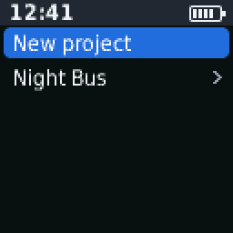
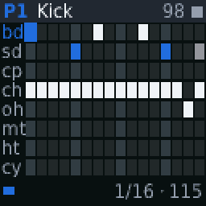
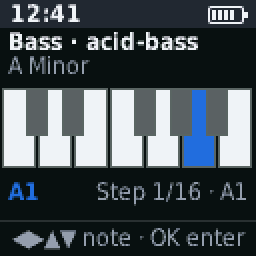

# Sequencer

**Not on the player yet.** The Sequencer runs only in the desktop simulator
and on the website's Try it page; the player's firmware does not include
it. (MIDI files do play on the player: [Music](music.md#midi-files).)

A drum machine with two synth tracks: patterns of steps, chained into a
song, exported as WAV and MIDI files. It is hidden from Home: start the
simulator with `--script "set:seq=on"`, or type
`orpheus.web.run_script('set:seq=on')` in the browser console on the Try
it page. Neither plays its sound yet.

## Projects

The first screen lists **New project** ("Beat 1", "Beat 2" …) and the
saved ones (Menu: Delete project, Settings). A project has 16
patterns of 1 to 64 steps, eight drum tracks from two kits, a bass and a
lead synth track, 40–240 BPM and swing of 50–75 %. Projects are kept in
`/.orpheus/seq/`. Back from the list stops playback.

## The grid

At the top: pattern, sound, tempo. Below: 16 steps of eight tracks (the
synth tracks scroll in below). Accented steps are in the accent colour,
quiet ones grey, steps with a chance below 100 % hollow.

| Key | Does |
|---|---|
| **Prev / Next** | Move along the steps; hold: by pages |
| **Up / Down** | Change track |
| **OK** | Step on or off |
| **Hold OK** | Edit the step |
| **Menu** | Play/Stop, Transport, Mixer, Track, patterns (next, previous, copy, clear), Save, Sound, Keys, More (Live, Song, Export WAV, Export MIDI) |
| **Back** | Save and return to the list |

## Editing screens

Prev and Next change a value; OK switches it on or off.

| Screen | Contents |
|---|---|
| **Step** | Velocity, chance, ratchet (1–4), delay, accent; synth tracks: note, length, chord; up to 24 locks per pattern |
| **Transport** | Play, tempo, swing, tap tempo, play mode (Pattern, Song), pattern, length, kits, scale, root, transpose, fill pattern |
| **Track** | Sound, kit, level, mute, solo |
| **Mixer** | OK mutes, hold OK solos, Prev/Next set the level |
| **Sound** | Drums: tune, decay, tone, snap, level, pan, sends. Synth: preset, wave, filter, envelope, vibrato, glide, voices, sends |

## Keys, Live and Song

**Keys**, a one-octave keyboard for the synth tracks: Prev and Next walk
the scale, Up and Down change octave, OK plays the note and enters it at
the step, hold OK takes it back. Menu › Record records while playing.

**Live**: hold OK for the fill; Prev and Next queue another pattern; Up
and Down change the tempo.

**Song** lists the entries ("P1 × 2"): Prev and Next change the pattern,
OK adds a repeat; Menu inserts a copy, deletes an entry or plays the song.

## Export

Export WAV or Export MIDI writes the song once (in Pattern mode, the
current pattern) next to the project: a 16-bit stereo WAV, or a MIDI file
(drums on channel 10, bass and lead on 1 and 2).

**Settings** (on the project list): default kit, length and swing,
metronome, count-in, step length (1/16, 1/8, 1/32), key clicks in play.

## Not yet

**In progress**: the Sequencer on the player, its sound in the simulator
and on Try it, and MIDI clock output over USB (with USB audio).
