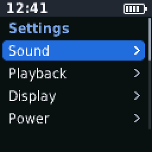
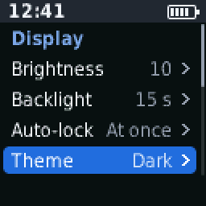
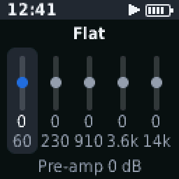

# Settings

Settings are grouped by topic. Changes apply at once and are kept when the
player is switched off; there is no Save button. Up and Down move, OK opens
or changes, Back goes up a level.

## Groups

| Group | What is in it | State |
|---|---|---|
| **Sound** | Equaliser (Flat, Rock, Pop, Jazz, Classical, Electronic, Hip-hop, Bass boost, Vocal, two custom curves), balance, bass, crossfeed, channel mode (stereo, mono, swapped), volume limit | Works |
| **Playback** | Shuffle, repeat, gapless, ReplayGain, resume at start, seek step | Works; speed and fades are **in progress** |
| **Display** | Brightness, backlight time, lock delay, screen saver (a dim clock), animations, rotation by 180°, theme (Dark, Light, Amber), accent colour, clock in the status bar, list roll-around, Home screen apps | Works; brightness and wallpaper are **in progress** |
| **Power** | Power mode (automatic, battery saver, high performance), sleep timer, auto-off, keys when locked (none, volume, volume and track keys), battery | Auto-off and low-battery switch-off are **being checked** on the player |
| **Date & time** | Time, date, 24-hour clock, date format, time zone, correction (seconds a day), set from the radio (RDS) | Works; the clock has stopped after some restarts (known issue: set it again) |
| **Bluetooth** | Device list, reconnect | See [Bluetooth](bluetooth.md) |
| **USB** | What happens when you plug into a computer: ask, charge only, file transfer (card reader); read-only card reader; developer channel (for the tools: [troubleshooting](troubleshooting.md)) | Charge only and file transfer work; the other choices are **in progress** |
| **Language** | English; Russian and Japanese | English works; the other languages run in the simulator and are **in progress** on the player |
| **Storage** | Card info, rebuild library, clear caches | Works |
| **System** | About, Performance, Diagnostics, Factory reset, Recovery mode | Works |

Radio and Recording groups belong to apps that are not built yet; their
settings are stored but do nothing.

**List roll-around** (on at first): in every list, Down on the last row
goes to the first and Up on the first row to the last; Prev and Next jump
round from the last page to the first the same way. Holding Up or Down
stops at the end of the list. Switch it off to make the ends stop.

## Equaliser

Sound › Equaliser lists the presets. The custom curves have five bands
(60 Hz, 230 Hz, 910 Hz, 3.6 kHz, 14 kHz, ±12 dB): Prev and Next choose a
band, Up and Down change it. The pre-amp follows by itself so the sound
does not clip.

While any sound effect is on, the player runs its processor a little
faster during playback; that costs a little battery.

## System

* **About**: version, build, serial number, hardware.
* **[Performance](performance.md)**: Normal or Maximum processor speed.
* **Factory reset**: every setting back to its default. Music, the library
  and your bookmarks on the card are not touched.
* **Recovery mode**: restarts into the chip's USB recovery mode, for the
  install tools ([troubleshooting](troubleshooting.md)).
* **Start original firmware**, if shown, does nothing useful: the original
  firmware is no longer on the player.

Pressing OK five times on About shows a **Developer** group until the next
restart (battery logging for tests). It is not needed for normal use.
