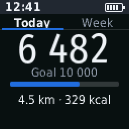
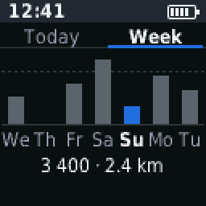
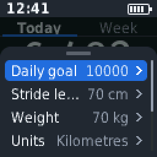

# Steps

Steps counts your steps with the player's motion sensor. It shows today's
count against a daily goal, and the last seven days as bars.

## Today and Week

**Prev** and **Next** switch between the two tabs; **Back** leaves.

* **Today**: the count, "Goal 10 000" (or "Goal reached"), a bar towards
  the goal, and the distance and energy (kcal) the count stands for.
* **Week**: one bar per day, today on the right, with the goal as a
  dotted line. **Up** and **Down** choose a day; its count and distance
  show under the bars.

If the player finds no motion sensor, Today says "No motion sensor".

## Menu

| Item | Values |
|---|---|
| **Daily goal** | 1 000–30 000 steps in steps of 500 (default 10 000) |
| **Stride length** | 30–150 cm (default 70); distance = steps × stride |
| **Weight** | 30–200 kg (default 70); used for the energy |
| **Units** | Kilometres or Miles |
| **Count in background** | **While on** (default): counts whenever the player is on, also with the screen off. **Off**: counts only while Steps is open; the strip says "Counts only here" |
| **Sensitivity** | Low, Medium (default), High |
| **Reset today…** | Sets today's count back to 0, after asking |

Distance and energy are estimates from these numbers, not medical data.

## History needs the clock

The player keeps today and the six days before in `/.orpheus/steps.bin`
on the card. It saves 10 minutes after the first new step, when the day
changes, at power-off and before the card goes to a computer.

If the clock is not set, the player still counts but keeps no history,
and the strip says "No clock: no history". Set the time in
[Settings](settings.md) › Date and time.

## What has been tested

The motion sensor works on the player and is read 25 times a second.
Steps is on Home, and its screens open on the player in the automatic
on-device tests. Whether the count is right over real walks has **not
been checked by a person yet** (user check 21 in
[USER-CHECKS.md](../USER-CHECKS.md)); if your count is far off, please
[report it](../../CONTRIBUTING.md#reporting-a-bug).

## Not yet

**In progress**: a Month tab (the history keeps seven days), counting
while the player is off, active minutes.
