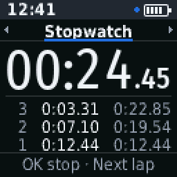
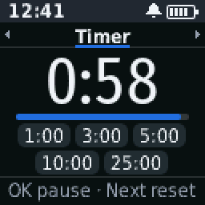
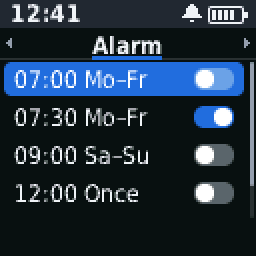
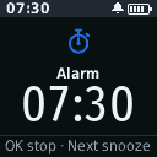

# Stopwatch

The Stopwatch app has three tabs: **Stopwatch**, **Timer** and **Alarm**.
The stopwatch and the timer keep running when you leave the app or the
screen goes off.

**Prev** goes to the previous tab. **Next** goes to the next tab when the
tab has no other use for it (below). The strip at the bottom shows the
keys; **Back** leaves.

## Stopwatch

| Key | Does |
|---|---|
| **OK** | Start / stop |
| **Next** | Running: take a lap. Stopped: reset (asks first if there are laps). Not started: next tab |
| **Up / Down** | Scroll the laps |

The time shows minutes, seconds and hundredths, and H:MM:SS from an
hour. Each lap row shows its number, the lap time and the time since the
start; the last 20 laps are listed.

## Timer

| Key | Does |
|---|---|
| **Up / Down** | Choose one of the last five durations (while not started) |
| **Menu** | **Set duration…**: Prev/Next choose hours, minutes or seconds, Up/Down change, OK sets. Up to 9 hours |
| **OK** | Start / pause / resume |
| **Next** | Started: back to the full duration. Otherwise: next tab |

A duration you start moves to the front of the five.

## Alarm

Four alarms, each with a time, repeat days and a switch. **Up/Down**
choose one; **OK** switches it on or off. **Menu › Time…** sets its time;
**Menu › Repeat…** lists the seven days, and OK ticks or unticks one. With
no day ticked the alarm rings once and then switches itself off.

Alarms follow the player's clock and do not ring while it is not set
([Settings](settings.md) › Date and time).

## When it rings

When the timer reaches zero or an alarm is due, an alert opens over any
screen: "Time's up" with the duration, or "Alarm" with the time. The
screen lights, the backlight flashes and a beep pattern plays through the
headphones at the current volume; music pauses and resumes afterwards. It
rings for a minute unless you stop it.

| Key | Does |
|---|---|
| **OK** or **Back** | Stop |
| **Next** | Alarm only: snooze; it rings again in 9 minutes |

## Status bar

A **bell** shows while an alarm is on, a timer runs or an alarm is
snoozed. A **dot** shows while the stopwatch runs. Auto-off waits while
the stopwatch or the timer runs.

## The player must be on

An alarm does **not** wake the player from off yet: it rings only while
the player is on (the screen may be off). The Alarm tab says "Rings only
while on". Switching the player off also stops the stopwatch and the
timer.

## What has been tested

The app is on Home on the player, and the stopwatch starts, stops and
resets in the automatic on-device tests. The timer and alarm alerts, the
beeps and the backlight flash have **not been checked by a person yet**
(user check 22 in [USER-CHECKS.md](../USER-CHECKS.md)).

## Not yet

**In progress**: alarms that wake the player from off, alarms that resume
music or start the radio, a rising volume, a stopwatch that survives a
restart.
