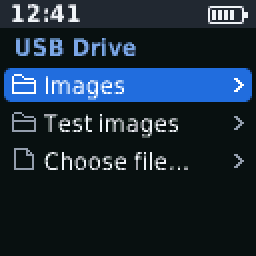
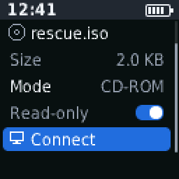
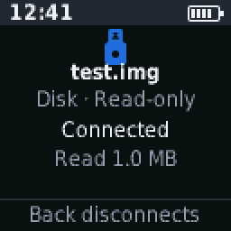

# USB Drive

USB Drive shows a disk image from the card to a computer as a CD-ROM or a
USB disk. The computer can then start from it: an installer, a rescue
system or a live Linux. On the player a Linux computer read a test disk
image and a test CD image byte for byte; starting a real computer from
one has not been checked by a person yet.

## Putting images on the card

Copy `.iso` or `.img` files (also `.bin`, `.raw`, `.vhd`) into a folder
called `Images` at the top of the card: connect the player and choose
**File transfer**, or use any card reader. A file copied in one go is
usually stored in one piece. A file stored in more than 682 pieces cannot
be shown: the app says "The file is too fragmented"; copy it to the card
again (on a card with free space, or after freeing space).

## Presenting an image

1. Home › USB Drive › **Images**, then OK on the image. **Choose file…**
   browses the whole card; other files are shown dimmed.
2. Check the options and press OK on **Connect**:

| Row | Meaning |
|---|---|
| **Mode** | **CD-ROM** for an `.iso` (as a DVD above 700 MB), **Disk** for anything else. **Fixed disk** is for computers whose boot menu lists only fixed disks. Many Linux ISO files also start as a Disk |
| **Read-only** | Always on: the computer cannot change your image |

3. Connect the player to the computer with the USB cable (or keep it
   connected). The screen shows the image, the mode, whether a computer
   uses it, and how much it has read.

4. Start the computer from the drive: its boot menu (often F12, F11, F8
   or Esc while it starts; Option on a Mac) lists the player as "Orpheus
   USB Drive".

While the image is shown, the card belongs to the computer: music,
Files, Pictures and the Recorder wait. **Back** disconnects; eject the
drive on the computer first. Ejecting it on the computer also ends it.
You can also open USB Drive from **Files** (OK on a disk image) or from
the "computer connected" question (**Present disk image…**).

## Test images

The folder `.orpheus/images` holds test images for the developers. It is
listed as **Test images** when it exists. Only these images can be
presented writable, and only in developer mode; the computer can then
change the image's contents but never its size or any other file.

## Not yet

**In progress**: starting with an image when the cable is plugged in
while holding Next, a list of the last images used, and showing the
transfer rate in the status bar.
